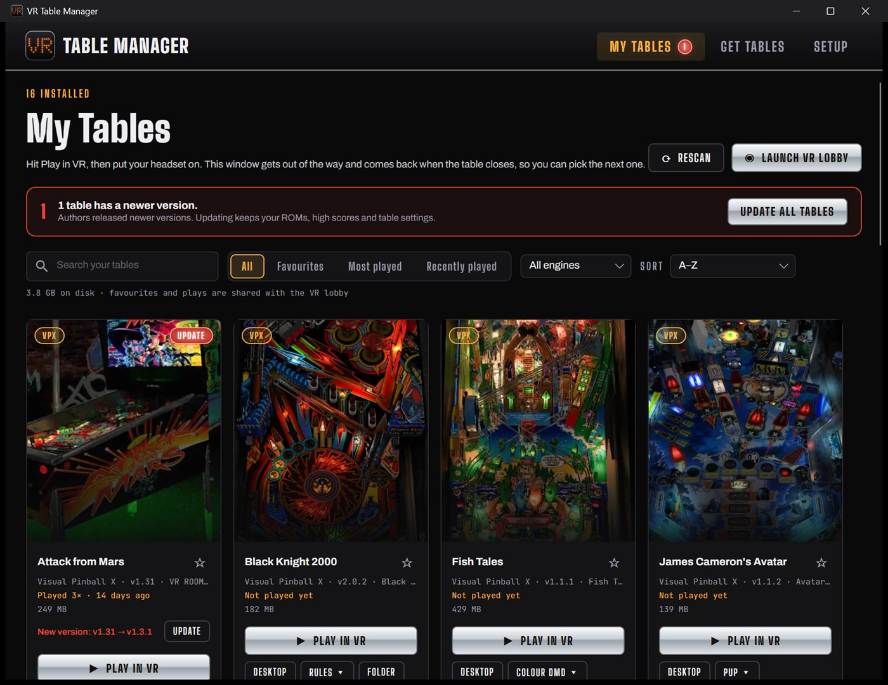
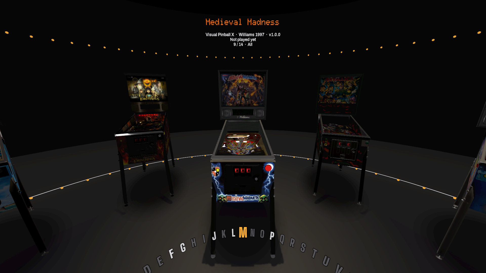
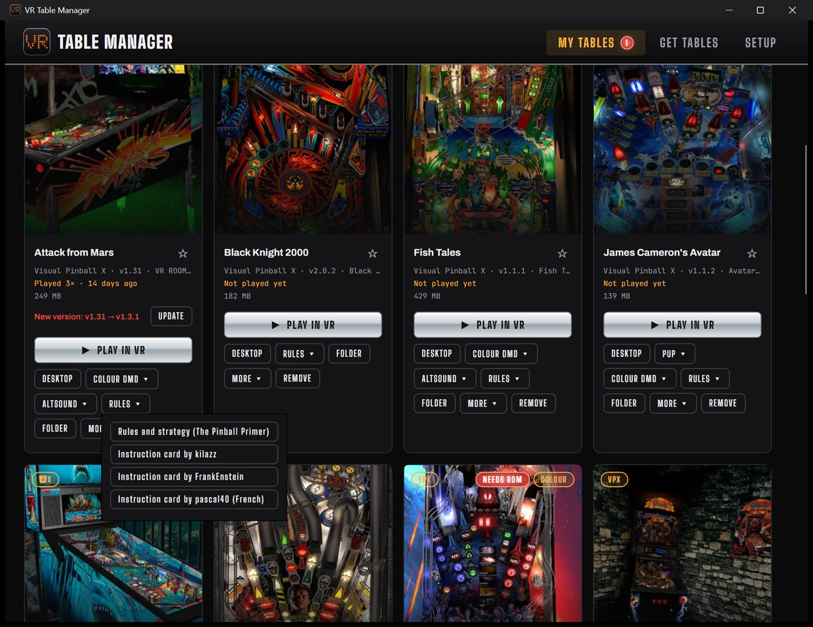
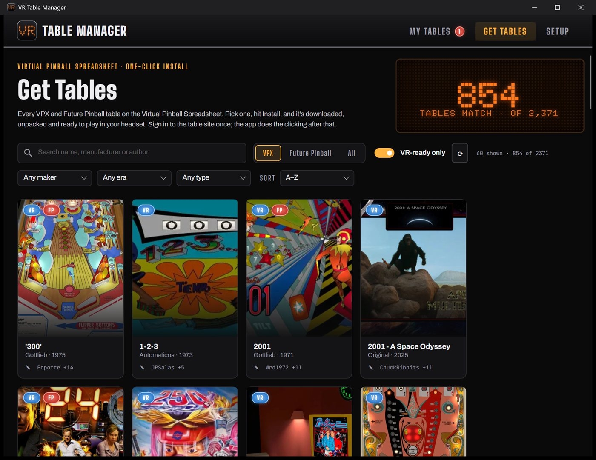
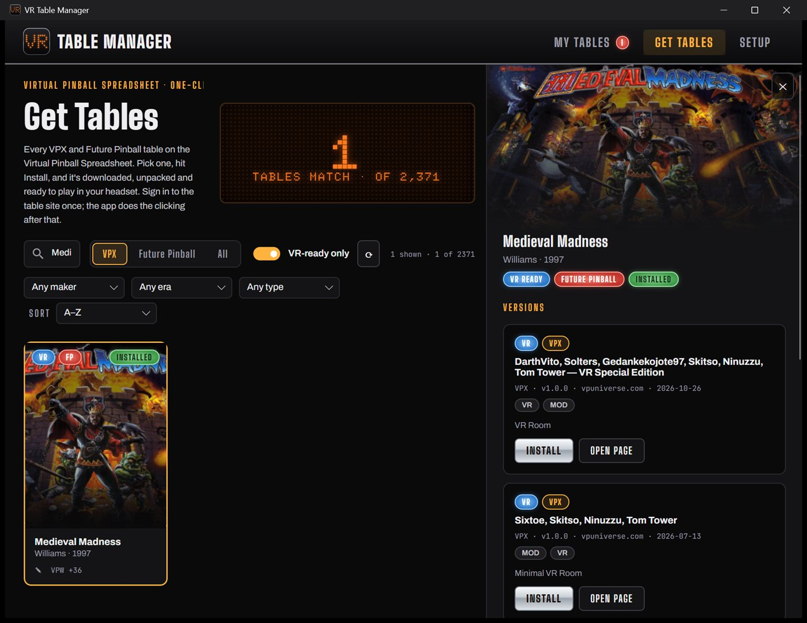
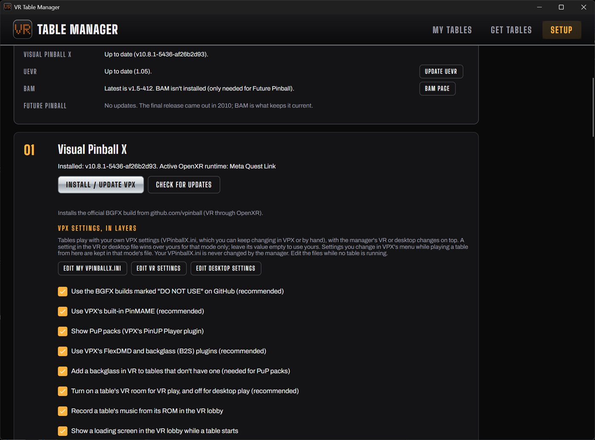
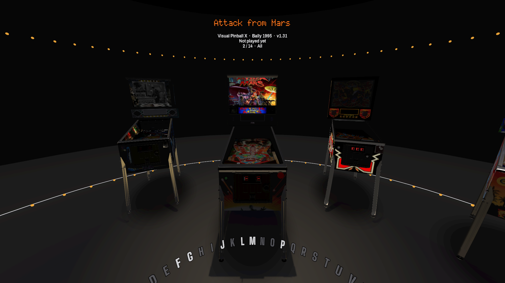
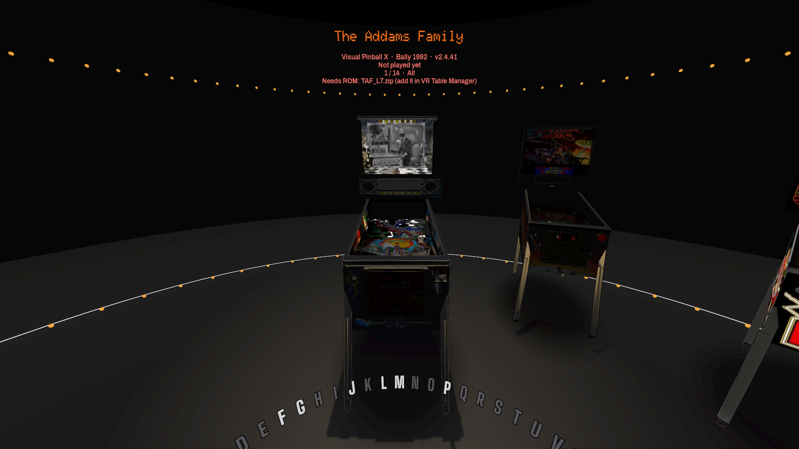

# VR Table Manager

**Virtual pinball in VR, without the setup headaches.** Pick a table from the 2,000+ in the Virtual Pinball Spreadsheet, click Install, and play it in your headset a few minutes later. VR Table Manager downloads the table, finds its ROM, adds the extras (PuP videos, colour DMD, remastered sound), keeps everything up to date, and launches it in VR. Then you can walk up to your collection in a 3D arcade lobby inside the headset and pick the next one.





Built for Meta Quest (Link, Air Link or Virtual Desktop) with the official Visual Pinball X 10.8.1 VR build. Future Pinball, Pinball FX and Pinball M are supported too.

## Features

### Get tables in one click
- **The whole catalog:** every VPX and Future Pinball table in the [Virtual Pinball Spreadsheet](https://virtualpinballspreadsheet.github.io/), filterable by VR-ready, maker, era and type, each with its versions, authors and features.
- **One-click install:** for VPUniverse, VPForums and other community sites, the table's page opens in your own browser so you see the site and accept its terms yourself; click Download and the app picks the file up from your Downloads folder and does the rest. GitHub and direct links download by themselves. Installs queue up and are offered again if you close the app mid-download.
- **Ready to play:** each table gets its own folder in the layout VPX 10.8.1 expects. The app reads the table's script to find the exact ROM it needs, then fetches it, including Stern's free game code. Its parent sets and aliases are handled for you.

### Make every table look and sound its best
- **PuP packs:** PinUP Player videos on the cabinet's backglass and DMD, shown in VR by VPX's PinUP plugin.
- **Colour DMDs:** Serum and Pin2DMD colorizations turn the orange dot-matrix display into full colour.
- **AltSound:** remastered and re-orchestrated soundtracks that replace the ROM's original sounds.
- **Rules:** The Pinball Primer's rules and strategy guide and the table's instruction cards, one click from each table.
- **Your own artwork:** replace a table's card picture, its VR lobby playfield and backglass, its lobby video and its attract music with your own. See [Custom artwork, videos and sounds](docs/custom-artwork.md).

Add-ons are matched to the table's ROM, installed where VPX's plugins look, and tracked, so a new version shows up as an update.

### Stay up to date
- **Updates for everything:** new table versions, new add-on versions, Visual Pinball X itself and UEVR, checked every time the app starts. Update one, or update all with one button.
- **Nothing lost:** updating a table keeps its ROMs, high scores and settings.

### Play in VR
- **One button:** **Play in VR** launches the table in your headset. The manager gets out of the way and comes back when you quit, ready for the next game.
- **The VR lobby:** your tables stand around you as 3D cabinets with real backglass art. Browse with an alphabet wheel, play a table's attract music, and launch it without taking the headset off.
- **Favourites, play history and high scores:** shared between the manager and the lobby. Grand champion scores are read straight from each table's saved memory.
- **Pinball FX and Pinball M:** launched through UEVR, with pinball-tuned VR settings applied automatically.

### Setup made easy
- Copies the tables of another VPX install (with their ROMs, NVRAM, AltSound, AltColor and PuP packs) into the per-table layout, leaving the other install untouched.
- Installs the official VPX VR build, checks your OpenXR runtime (Meta Quest Link, Virtual Desktop, SteamVR), and sets refresh rate, spacewarp and graphics quality.
- Explains what went wrong when a table crashes or exits early, using VPX's own log.
- Shows disk use, sets render scale per table, clears caches, and backs up your settings and play history.

## Screenshots

| | |
|---|---|
|  |  |
| **Add-ons and rules** on every table card | **Get Tables:** 2,000+ tables, filtered to what works in VR |
|  |  |
| **Every version** of a table, with one-click Install | **Setup and updates** in one place |

| | |
|---|---|
|  |  |
| **The VR lobby:** a backglass from the catalog fills in when a cabinet has none | Browse your collection with the alphabet wheel |

## Try it

1. Download the latest `VrTableManager-<version>-win-x64.zip` from [Releases](https://github.com/mikebm/VRTableManager/releases), unzip it anywhere and run `VrTableManager.exe`.
2. On **Setup**, install Visual Pinball X with one click and make sure your headset's OpenXR runtime is active (Meta Quest Link or Virtual Desktop).
3. On **Get Tables**, pick a VR-ready table and click **Install**. Its page opens in your browser: sign in if asked, accept the site's terms and click Download. The app takes it from there.
4. Put your headset on and hit **Play in VR**, or **Launch VR Lobby** to browse your collection in the headset.

You'll need Windows 10/11 (64-bit) and a web browser. The VR lobby also needs the [.NET 10 Runtime](https://dotnet.microsoft.com/download/dotnet/10.0). It downloads the Godot engine it runs on by itself the first time you start it.

## Build from source

### Requirements

- Windows
- [.NET 10 SDK](https://dotnet.microsoft.com/download)
- For the VR lobby: [Godot 4.7.2 .NET](https://godotengine.org/download) (the .NET edition is required for C#)
- For VR play: a configured OpenXR runtime and the relevant pinball games/tools. See the [manager guide](VrTableManager/README.md) and [lobby guide](VrLobby/README.md) for engine-specific requirements.

### Build and run

From the repository root, build the solution:

```powershell
dotnet build "VR Table Manager.slnx"
```

Run the desktop manager:

```powershell
dotnet run --project VrTableManager
```

Run the companion lobby with the Godot .NET executable:

```powershell
godot --path VrLobby
```

Open the manager once before using the lobby so it can record its executable path. VR hardware is not required to run the manager, build the projects, or open the lobby in desktop mode.

### Run checks

Run the console smoke-test suite:

```powershell
dotnet run --project SmokeTest
```

Run the lobby's Godot scene self-test:

```powershell
godot --headless --path VrLobby -- --selftest
```

The smoke tests may access online catalogs or release/site endpoints, so some checks depend on network availability.

## Projects

| Project | Description |
| --- | --- |
| [VrTableManager](VrTableManager/README.md) | Avalonia desktop app for browsing and installing tables, configuring engines, and launching games. |
| [VrTableManager.Core](VrTableManager.Core/VrTableManager.Core.csproj) | Shared models, table services, engines, play tracking, and lobby logic. |
| [VrLobby](VrLobby/README.md) | Godot C# VR lobby with table browsing, favorites, filters, and launch/return flow. |
| [SmokeTest](SmokeTest/SmokeTest.csproj) | Console-based integration and behavior checks. |
| [tools/IconGen](tools/IconGen/IconGen.csproj) | Utility for generating the desktop application icon. |

## Guides

- [Desktop manager: features, engine setup, installation, and updates](VrTableManager/README.md)
- [VR lobby: setup, controls, behavior, and test coverage](VrLobby/README.md)
- [Custom artwork, videos and sounds: card pictures, lobby playfields, backglasses, videos and attract music](docs/custom-artwork.md)

## Releasing

[`scripts/release.ps1`](scripts/release.ps1) builds a Windows release and publishes it on GitHub:

```powershell
.\scripts\release.ps1 -Version 1.0.0 -NoPublish   # build and zip only, into artifacts\release
.\scripts\release.ps1 -Version 1.0.0              # also tag v1.0.0 and create the GitHub release
```

It runs the smoke test, publishes the manager self-contained for win-x64, bundles the VR lobby
(already compiled, so players don't need the .NET SDK) and attaches
`VrTableManager-<version>-win-x64.zip` and its `.sha256` to the release, with GitHub's generated
change list. The working tree must be clean and pushed. Other options: `-Draft`, `-Prerelease`,
`-Notes "…"` or `-NotesFile notes.md`, `-SkipTests`, `-Repo owner/name`.

For GitHub access it uses `GITHUB_TOKEN` or `GH_TOKEN` if set, then the GitHub CLI's sign-in, then
the credential Git already uses for github.com. The token needs `contents: write` on the repository.

## Credits

- Table data from the [Virtual Pinball Spreadsheet](https://virtualpinballspreadsheet.github.io/).
- High scores are read with maps from the [Pinball Memory Maps](https://github.com/tomlogic/pinball-memory-maps) project. This program makes use of content from the Pinball Memory Maps project, available under the [Open Database License (ODbL) v1.0](http://opendatacommons.org/licenses/odbl/1.0/).
- Rules and strategy pages from [The Pinball Primer](https://pinballprimer.github.io/).

## License

VR Table Manager is released under the [MIT License](LICENSE). The libraries, fonts and data it uses are under their own
licenses; see [THIRD-PARTY-NOTICES.md](THIRD-PARTY-NOTICES.md).
