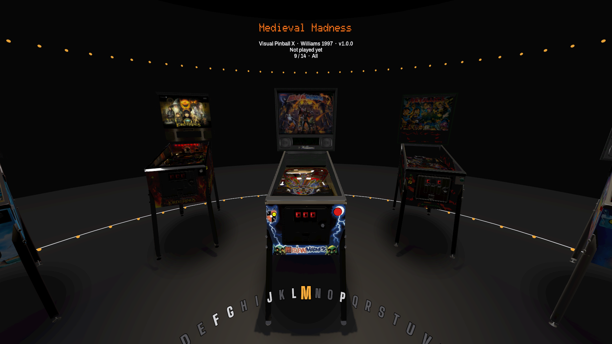
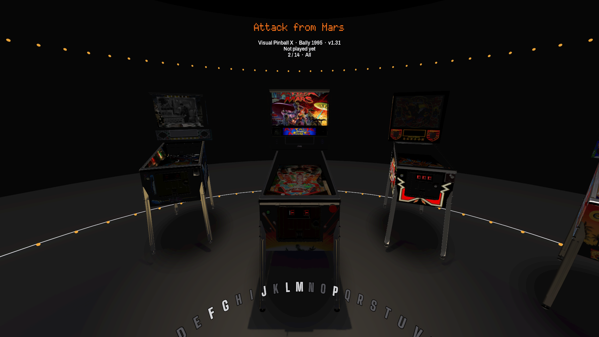
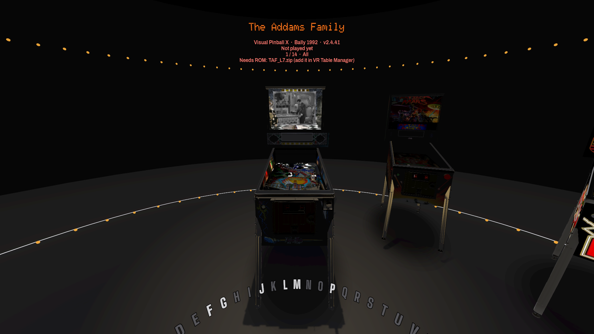
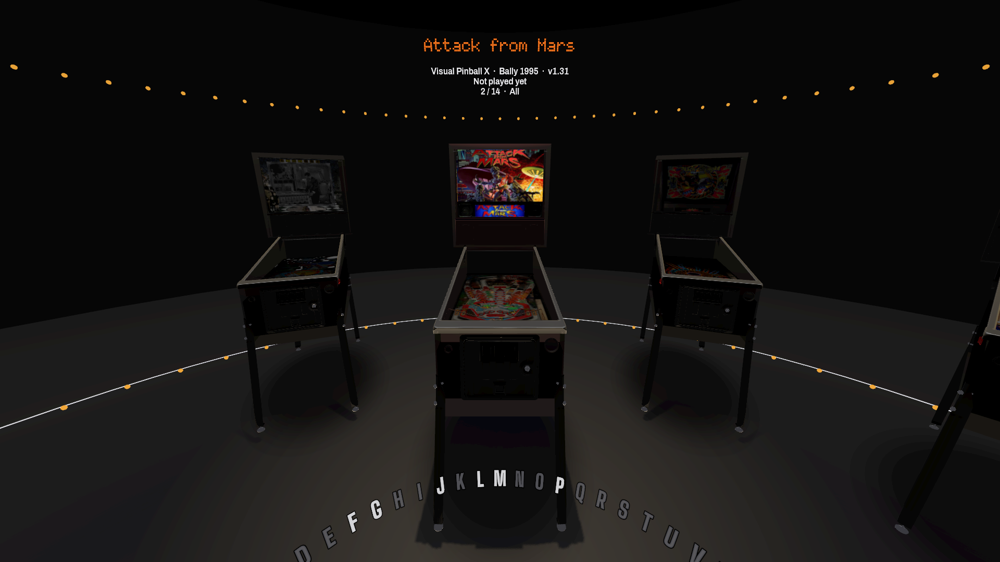

# VR Pinball Lobby (prototype)

An in-headset table picker for **VR Table Manager**. Your tables stand around you as **3D pinball cabinets** in a dark room lined with warm lamp bulbs and chrome edges, in VR Table Manager's "DMD & lamps" style. Each one shows its real playfield under glass and its real backglass, with chrome rails, a lockdown bar and a speaker panel. The selected cabinet steps up in front of you under a spotlight. Turn the ring with the thumbstick, jump through the alphabet with the **A–Z rail** at your knees, and pull the trigger to play. You land back in the lobby, on the same table, when you exit.

It's written in **C#** (Godot 4.7 .NET) on top of `VrTableManager.Core`, the same library the manager uses. So the lobby lists exactly what the manager knows about (VPX, Future Pinball, Pinball FX and Pinball M) and launches through the same engine code. Favourites and play history are shared with the manager too.



| Attack from Mars | The Addams Family |
|---|---|
|  |  |

(Desktop-mode renders of the tables installed on this PC, 1920×1080. In the headset you stand about where the camera is.)

## Run it

1. Install [Godot 4.7 **.NET**](https://godotengine.org/download) (the .NET edition; the standard one can't run C#) and the [.NET 10 SDK](https://dotnet.microsoft.com/download).
2. Open **VR Table Manager** once. It records where its exe is, so the lobby can launch tables through it. (The manager's **Launch VR Lobby** button does steps 4–5 for you.)
3. Put on the Quest 3, connect Quest Link / Air Link (or Virtual Desktop), and make sure an OpenXR runtime is active.
4. From the `VR Table Manager` folder:

```bash
dotnet build VrLobby/VrLobby.csproj
```

```bash
godot --path VrLobby
```

(`godot` is the Godot .NET editor exe.) No headset? It opens in a normal window instead, with the keyboard controls below.

### Controls

| VR | Keyboard | Action |
|---|---|---|
| Stick ← → (either hand) | ← → | Turn the ring to the previous / next table. Hold to keep going; it speeds up after a second. |
| Stick ↑ ↓ (either hand) | ↑ ↓, PgUp / PgDn | Jump to the previous / next letter (or manufacturer / decade) |
| Point at a cabinet | – | Selects it |
| Point at a rail letter + Trigger | Type a letter | Jump to that letter |
| Trigger or A | Enter | Play the selected table |
| **Y** | **Ctrl+R** or **?** | **Random table** (plain letters are taken by the A–Z jump) |
| B | Tab | Next filter |
| Right grip | F | Favourite / unfavourite (★ above the cabinet) |
| Hold left grip + left stick ↑ ↓ | + / − | Raise / lower yourself (see below) |
| Hold left grip + click left stick | Home | Reset height |
| Menu | Esc | Quit the lobby |

The old flat "wall" view is gone: the cabinet ring replaces it, and the thumbstick click no longer switches views.

### Getting to the M tables (in a 100-table library)

- **Fastest:** point the right-hand laser at **M** on the rail and pull the trigger.
- **By stick:** push the stick **down** to jump letter by letter (#, A, B …). Hold it and the jumps speed up, so # to M takes about 2 seconds. A big letter flashes so you know where you are.
- **Desktop:** press **M** on the keyboard.

Empty letters are greyed out on the rail and skipped. "The …" titles file and sort under their second word (The Getaway → G).

### The cabinets

Each table stands in **its own VR cabinet**, the 3D cabinet its author built into the `.vpx`: the real side art, backbox, speaker panel, lockdown bar, legs and coin door you'd see playing it in VPX VR. All 12 tables on this PC have one.

- **How it's read:** the lobby picks out the cabinet parts (named like `PinCab_Cabinet`, `PinCab_Rails`, `Lockdownbar`, `VR_Legs…`) and leaves out the playfield's own toys and bolts, the VR room, and lighting overlays. It decodes their meshes and places them with VPX's own transform maths, at real size: about 0.72 m wide and 1.9 m to the top of the backbox. Parts that VPX draws "unlit" (backglasses, baked art) show as they are.
- **When:** in the background the first time a cabinet comes into view. That takes 50–500 ms per table, plus texture decoding. Textures are capped at 1024 px and GPU-compressed (DXT). The 14 most recent cabinets stay in memory. No "extract" step is needed.
- **Cabinet cache:** what was read (merged meshes, materials, the compressed textures, playfield and backbox placement) is saved to `%APPDATA%\VrTableManager\cabinet-cache`, one `.cab` file per table (about 12 MB for Attack from Mars). Since the lobby restarts after every game, later visits load from there instead: Attack from Mars takes about 25 ms instead of 450 ms. A file is re-read when its table's size or date changes. Tables without a VR cabinet are remembered too. Delete the folder to start over.
- **Tables without their own cabinet** (desktop-only tables, Future Pinball, Pinball FX / M) borrow a **template cabinet**: your installed **Medieval Madness** VR cabinet, or the next installed table that has one. The template keeps its shape and hardware (body, chrome, legs, coin door, speakers), but its printed art becomes that table's side colour, and that table's own backglass goes on the backbox. It's read from your own table file at run time; nothing is copied into the app. To preview it on every table, start the lobby with `-- --borrow-all`.
- **No VR tables at all:** a drawn cabinet (chrome rails and lockdown bar, splayed legs with levelers, speaker panel with an orange DMD).
- **Playfield:** read straight out of the table's `.vpx`, at up to 2048 px, extracted once per table version into `%APPDATA%\VrTableManager\img-cache`. If a table has no usable flat playfield picture, its VPS picture is used instead. Metallica (Premium Monsters) is one: its playfield is baked into lighting atlases.
- **Backglass:** the cabinet's own backglass when it has one. Otherwise the game's picture from the cached VPS catalog (`vpsdb.json`, no network), on the cabinet's backglass or on a panel on its backbox. With no picture at all, a lit title plate shows the table's name.
- **Attract sound:** if a VPX table's folder (or its `music` folder) has an `.ogg` / `.mp3` / `.wav`, about 10 seconds of it plays quietly from the backbox when you settle on that cabinet. Names with "attract", "intro" or "theme" are preferred. None of the tables on this PC have one, so the self-test checks it with a test file.



### Filters (B / Tab)

All → VPX → Future Pinball → Pinball FX → Pinball M → Recently played → Most played → Favourites → Manufacturer → Decade.

- **Manufacturer** and **Decade** sort the tables into groups, and the rail shows those groups (Bally, Gottlieb, Stern … / 1970s, 1980s …) instead of letters.
- **Recently played** shows the last 30 tables you launched, newest first. **Most played** shows the 30 with the most plays.
- **Pinball FX** and **Pinball M** each appear as one cabinet when the game is installed. You pick the table inside the game.
- An empty filter says why, for example "No plays counted yet" or "Pinball M isn't installed".

### Favourites and play history (shared with the manager)

- **Shared file:** favourites, play counts, time played and last played live in `%APPDATA%\VrTableManager\play-stats.json`, shared with VR Table Manager. A favourite starred in either place shows up in the other, within 2 seconds while the lobby is open.
- **Status line:** the selected table's status shows, for example, "Played 12× · 3 h 20 min · last played yesterday".
- **What counts as a play:** a play is counted by the manager's `--play` launcher once the table actually starts.
- **Lobby settings:** the lobby keeps its filter and height in `%APPDATA%\VrTableManager\lobby-state.json`.

### If your height looks wrong

The lobby puts the floor where the Quest's Guardian says it is (OpenXR **Local Floor**). If the cabinets feel too tall or too short:
- **Adjust:** hold the **left grip** and push the **left stick** up or down (about 30 cm per second, up to ±60 cm; a "Height +12 cm" readout appears).
- **Reset:** hold the left grip and **click the left stick**.
- **Saved:** the adjustment is saved and comes back every time the lobby starts.
- **Recentering:** holding the Oculus button recenters your direction but leaves your height alone.

### Look ("DMD & lamps", shared with the manager)

- **Room:** neutral black and charcoal (`#0A0A0B`, `#141416`, `#1E1E21`). The floor and far wall are dark grey, so the only warm light comes from rows of small incandescent lamp bulbs (`#FFB23E`) and the displays. Chrome edges trace the floor.
- **Display text:** the selected table's title, the big A–Z flash letter, and each cabinet's display use DMD plasma orange `#FF7A1F` in **Doto**, a dot-matrix font.
- **Lit things:** the current rail letter, the laser, the favourite star, the spotlight tint and the selected cabinet's backbox strip and coin lights are lamp amber.
- **Table types:** the other cabinets' lights use playfield-insert colours: blue `#3F95E8` VPX, red `#E5483B` Future Pinball, green `#63C46E` Pinball FX / M.
- **Fonts:** **Big Shoulders Display** for the rail and title plates, **Archivo** for the status and help text, **Doto** for display text. All are OFL-licensed, with copies and licences in `fonts/`.
- **Icon:** the manager's icon ("VR" in orange dot-matrix plasma dots on a black tile with a chrome edge, `icon.png`) is the window and app icon.

## How it works

```
VrTableManager.Core   models, table scanning, engines (VPX / Future Pinball / Pinball FX + UEVR),
                      headless play mode, lobby navigation + saved state, cabinet art lookups,
                      .vpx playfield extraction (VpxImages)
  ├─ VrTableManager   the Avalonia manager app (also: VrTableManager.exe --play …)
  ├─ VrLobby          this Godot C# project: room, cabinets, input, artwork
  └─ SmokeTest        plain-dotnet tests, including the lobby's navigation, art and play round trip
```

- **Cabinets are pooled:** only 11 cabinet nodes ever exist, however big the library. Table *i* always uses cabinet *i* mod 11, so turning the ring one step re-dresses a single cabinet.
- **Art loading:** pictures load only once the ring has nearly stopped, so flying through the alphabet doesn't decode art nobody sees. Decoding happens off the main thread. Only the 40 most recent pictures stay cached.
- **Cost per cabinet:** the geometry is built in code (`CabinetKit`) and shared by all cabinets, about ten draw calls each. There's one shadow-casting spotlight (on the selected cabinet), blob shadows under the others, 4× MSAA, and 16× anisotropic filtering for the playfields.
- **Chrome reflections:** the room's background is flat black, but reflections come from a small generated map (a soft ceiling light and a warm band of lamps), so chrome reads as chrome.
- **Launching:** the lobby checks that the engine is set up, then starts `VrTableManager.exe --play <table> --vr --return <lobby>`. That plays the table through the same engine as the manager's **Play in VR** button, waits for it to exit, and starts the lobby again with `--select=<table>`.
- **Handing over the headset:** the lobby **quits** instead of pausing, so the table never competes with it for the headset.

## What was verified, and what wasn't

Verified on this PC (no headset connected):
- **SmokeTest** (`dotnet run --project SmokeTest`), 138 checks, all passing. The lobby-related ones cover:
  - VR cabinets from a synthetic `.vpx`: raw and zlib meshes, VPX's transform order and axis mapping, winding, the nested material format, anchoring, and leaving out playfield bolts and the VR room; plus this PC's real Medieval Madness cabinet coming out real-size
  - A–Z navigation, with every rail letter one contiguous run
  - the backglass and playfield choices, and attract-sound picking
  - the cached VPS catalog: 2,116 of 2,645 games have a backglass picture
  - `.vpx` extraction on a synthetic table file: named image, the "named image isn't a playfield" fallback, caching, a damaged file
  - this PC's real Attack from Mars giving its 1824×4096 playfield
- **In-engine self-test** (`godot --headless --path VrLobby -- --selftest`), 43 checks, all passing, including: this PC's real Attack from Mars cabinet built in Godot (26 surfaces, 15 DXT-compressed textures, real size, playfield located, ~0.4 s), and a second load of it coming from the cabinet cache, identical and faster (~25 ms); tables without a cabinet borrowing the template; and the drawn cabinet when there's no template. Also:
  - the pool of 11 cabinets, the selected cabinet straight ahead at 0.9 m with the rest on the ring behind
  - one step re-dressing exactly one cabinet, typing M
  - backglass vs title plate, the side tint following the art, the 1024 px cap, and only the selected cabinet lit lamp-amber
  - Random always picking a different table
  - the attract sound playing from a table folder and stopping when you move on
  - filters, favourites and play stats, and height
- **Real tables:** `.vpx` playfields extract from 10 of the 12 installed tables in 20–140 ms each. Fish Tales and Metallica don't name a usable playfield image. Fish Tales is found by name ("FT_PF_…"); Metallica uses the VPS picture.
- **Rendered frames** at 1080p with the installed tables (screenshots above): each table in its own VR cabinet, a VPS backglass filling in where a cabinet has none (Attack from Mars, The Addams Family), every table in the borrowed Medieval Madness cabinet, and `--select` returning to the right table.
- **Crash dump:** the one Godot crash dump on this PC (Oct 17) came from the editor's first headless import of the C# project, not from the lobby. None of the many runs since has produced another.

**Not verified (needs the headset):**
- **Inside the headset:**
  - rendering, frame rate and comfort in the Quest 3 over Link / Air Link
  - the cabinet scale (does the selected one feel life-size at 0.9 m?)
  - the knee-height rail: is it easy to point at and read?
  - the title and stats floating above the backbox
- **Controls:** stick, trigger, Y (random), B, grips, the laser on cabinets and rail letters, and haptics.
- **Performance:** a full ring of real cabinets is roughly 0.3–1.5 million triangles (Fish Tales alone is 235k vertices) plus DXT textures; fine for a PC GPU, but check the frame rate over Link when turning the ring quickly. Also watch the moment a cabinet switches from the template to its own as it finishes loading.
- **The OpenXR handover:** the lobby quitting, the table starting in VR, then the lobby coming back. Expect a few seconds of black or loading view.
- **Attract sounds:** with a real table folder that has music (none here).
- **Future Pinball (BAM-OpenVR + SteamVR), and Pinball FX / M through UEVR:** UEVR isn't installed on this PC.
- **Height:** that Local Floor puts you at the right height, and the left-grip height control.

## Not included (ideas for later)

- Cabinet side art from the table's own files (VPX tables often include cabinet art images), and wheel art.
- Lit inserts / attract-mode light shows on the playfield, or a video backglass.
- A Godot Windows export preset (needs export templates installed).
