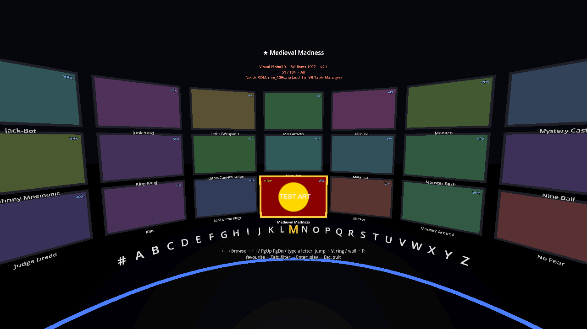

# VR Pinball Lobby (prototype)

An in-headset table picker for **VR Table Manager**. Your installed tables stand around you, either as a **ring** (one big card at a time) or a **wall** (a 3-row grid, about 27 tables in view). Click the thumbstick to switch between them. An **A–Z rail** at waist height jumps straight to a letter. Pull the trigger to play, and you land back in the lobby on the same table when you exit.

It's written in **C#** (Godot 4.7 .NET) on top of `VrTableManager.Core`, the same library the manager uses. So the lobby lists exactly what the manager knows about (VPX, Future Pinball, Pinball FX and Pinball M) and launches through the same engine code. Favourites and play history are shared with the manager too.

| Ring | Wall |
|---|---|
|  |  |

(Rendered from a 100-table test library; only Medieval Madness has test artwork, the rest show placeholder colours.)

## Run it

1. Install [Godot 4.7 **.NET**](https://godotengine.org/download) (the .NET edition; the standard one can't run C#) and the [.NET 10 SDK](https://dotnet.microsoft.com/download).
2. Open **VR Table Manager** once. It records where its exe is, so the lobby can launch tables through it.
3. Put on the Quest 3, connect Quest Link / Air Link (or Virtual Desktop), and make sure an OpenXR runtime is active.
4. From the `VR Table Manager` folder:

```bash
dotnet build "VR Table Manager.slnx"
```

```bash
godot --path VrLobby
```

(`godot` is the Godot .NET editor exe.) No headset? It opens in a normal window instead, with the keyboard controls below.

To make a standalone `.exe`: open the project in the Godot .NET editor → Project → Export → add "Windows Desktop" (install export templates when asked) → Export Project. Put the export next to `VrTableManager.exe`, or just open the manager once.

### Getting to the M tables (in a 100-table library)

- **Fastest:** point the right-hand laser at **M** on the rail and pull the trigger.
- **By stick:** push the stick **down** to jump letter by letter (#, A, B …). Hold it and the jumps speed up, so # to M takes about 2 seconds. A big letter flashes so you know where you are.
- **Desktop:** press **M** on the keyboard.

Empty letters are greyed out on the rail and skipped. "The …" titles file under their second word (The Getaway → G).

### Controls

| VR | Keyboard | Action |
|---|---|---|
| Stick ← → (either hand) | ← → | Previous / next table. Hold to scroll; it speeds up after a second. On the wall, one column per step. |
| Stick ↑ ↓ (left hand; right hand too in the ring) | ↑ ↓ (ring), PgUp / PgDn | Jump to the previous / next letter or group |
| Right stick ↑ ↓ (wall only) | ↑ ↓ (wall) | Move up / down a row |
| Point at a card | – | Selects it |
| Point at a rail letter + Trigger | Type a letter | Jump to that letter |
| Trigger or A | Enter | Play the selected table |
| Click the thumbstick | V | Switch ring ↔ wall |
| Right grip | F | Favourite / unfavourite (★) |
| Hold left grip + left stick ↑ ↓ | + / − | Raise / lower yourself (see below) |
| Hold left grip + click left stick | Home | Reset height |
| B | Tab | Next filter |
| Menu | Esc | Quit the lobby |

### If your height looks wrong

The lobby puts the floor where the Quest's Guardian says it is (OpenXR **Local Floor**). If the cards feel too high or too low:

- **Adjust:** hold the **left grip** and push the **left stick up** (taller) or **down** (shorter). It moves smoothly at about 30 cm per second, up to ±60 cm, and a "Height +12 cm" readout appears in front of you. While you hold the grip, the left stick does nothing else.
- **Reset:** hold the left grip and **click the left stick**.
- **Saved:** the adjustment is saved when you let go and comes back every time the lobby starts, including after a table.
- **Recentering:** holding the Oculus button recenters your direction but leaves your height alone.

If the floor itself is wrong everywhere (not just in the lobby), redo the Quest's floor level in Guardian settings instead. The lobby offset only changes the lobby, not VPX.

### Filters (B / Tab)

All → VPX → Future Pinball → Pinball FX → Pinball M → Recently played → Most played → Favourites → Manufacturer → Decade.

- **Manufacturer** and **Decade** sort the tables into groups, and the rail shows those groups (Bally, Gottlieb, Stern … / 1970s, 1980s …) instead of letters.
- **Recently played** shows the last 30 tables you launched, newest first. **Most played** shows the 30 with the most plays (ties go to the more recent).
- **Pinball FX** and **Pinball M** (badged FX / M) each appear as one entry when the game is installed. You pick the table inside the game.
- An empty filter says why, for example "No plays counted yet" or "Pinball M isn't installed".

### Favourites and play history (shared with the manager)

- **Shared file:** favourites, play counts, time played and last played live in `%APPDATA%\VrTableManager\play-stats.json`, which VR Table Manager uses too. Starring a table in either place shows up in the other.
- **Live updates:** the lobby re-checks the file every 2 seconds, so a favourite changed in the manager appears while the lobby is open.
- **Stats line:** the selected table's status shows its stats, for example "Played 12× · 3 h 20 min · last played yesterday", or "Not played yet".
- **What counts as a play:** a play is counted by VR Table Manager's `--play` launcher once the table actually starts, and the time when it closes. A launch that fails doesn't count.
- **The lobby's own settings:** the lobby keeps its filter, view and height in `%APPDATA%\VrTableManager\lobby-state.json`.

## How it works

```
VrTableManager.Core   models, table scanning, engines (VPX / Future Pinball / Pinball FX + UEVR),
                      headless play mode, lobby navigation + saved state
  ├─ VrTableManager   the Avalonia manager app (also: VrTableManager.exe --play …)
  ├─ VrLobby          this Godot C# project: scene, input, artwork
  └─ SmokeTest        plain-dotnet tests, including the lobby's navigation and play round trip
```

- **Tables:** `LobbyLibrary.Load` calls the manager's own `TableInstaller.Scan`: VPX folders with `vrtm.json`, Future Pinball tables, hand-installed tables, plus engine-owned entries such as Pinball FX (found on Steam/Epic). Missing ROMs are flagged in red.
- **Artwork:** read from the manager's image cache (`%APPDATA%\VrTableManager\img-cache`), downloading into it when missing, 4 at a time.
- **Launching:**
  1. The lobby checks that the engine is set up, then starts `VrTableManager.exe --play <table> --vr --return <lobby> --return-arg …`.
  2. That headless mode launches the table through the same `IPinballEngine` the manager's **Play in VR** button uses: VPX with the VR ini, BAM's FPLoader, or UEVR + Pinball FX.
  3. It waits for the game to exit, then starts the lobby again with `--select=<table>`.
  4. Each step is logged to `%APPDATA%\VrTableManager\play.log`.
- **Handing over the headset:** the lobby **quits** instead of pausing. That fully ends its OpenXR session, so the table never competes with it for the headset.

## Why Godot (and C#)

- **Godot vs Unity:** OpenXR is built in, with no plugins or account. The project is a few text files, and the editor is a single ~180 MB exe. Unity's advantage is its VR toolkits and asset store, which a table picker doesn't need.
- **C# vs GDScript:** the first prototype was GDScript, which duplicated the manager's scanning and launch logic. In C# the lobby shares `VrTableManager.Core`, so there's one implementation, one language, and Pinball FX shows up for free.
- **Trade-off:** running the lobby natively on the Quest (Android) would be easier in GDScript, since Godot's C# support on Android has been experimental. This lobby is PC-only, like the tables it launches.

What I took from the prior art ([vr-pinball-launcher](https://github.com/keithbphillips/vr-pinball-launcher), Unity): trigger and A to launch, stick browsing, and returning when the table exits. That project hides its menu and waits, and lists "menu sometimes fails to return" as a known issue. Quitting and relaunching avoids that whole class of problem.

## What was verified, and what wasn't

Verified on this PC (no headset connected):
- **SmokeTest** (`dotnet run --project SmokeTest`), all passing, including a new lobby section:
  - the library from a 100-table fixture
  - A–Z groups and jumping (M in 13 jumps instead of 48 single steps)
  - up/down within and between groups, typed keys
  - manufacturer and decade groups, the Future Pinball / favourites / recently played filters
  - state surviving a restart, and the stick speeding up
- **The real play round trip:** `VrTableManager.exe --play` launched a stand-in "VPX" through the VPX engine with VR on and wrote the VR ini. It waited for the table to exit, then started the stand-in lobby, as the log shows.
- **Height maths and saving (SmokeTest):** 30 cm/s at full stick, the dead zone, the ±60 cm clamp, the readout text, saving across restarts, and clamping a bad saved value.
- **In-engine self-test** under Godot 4.7.2 .NET (`godot --headless --path VrLobby -- --selftest`), 23 checks:
  - one card per table, 6 visible in the ring, the 27-letter rail
  - typing M, the wall showing a 3×9 grid while keeping the selection
  - the filter cycle, and the manufacturer rail
  - height: the rig moving 12 cm, saving to the state file, the clamp, and reset
  - shared stats:
    - the Pinball M and Most played filters, and the empty Most played message
    - picking up favourites and plays written by another process while open, and not re-reading an unchanged file
    - Most played ordering, and the "Played 2× · 45 min · last played 30 min ago" status line
    - a manager-set favourite showing in the lobby, and un-favouriting writing back to the shared file
    - the Pinball M filter showing this PC's installed game, badged M
- **Wording (SmokeTest):** time played, "last played" and empty-filter text.
- **Rendered frame:** the stats line fits between the title and the card.
- **Saved height on startup:** a rendered frame with a saved +30 cm shows the view raised.
- **Reference space:** `reference_space=2` is Local Floor, checked against the enum in the Godot 4.7.2 binary.
- **Rendered frames** in desktop fallback (screenshots above):
  - both views, the rail highlighting M, the favourite star
  - artwork from the manager's cache, the missing-ROM warning
  - `--select` resuming on the right table
- **No headset:** with SteamVR as the OpenXR runtime, OpenXR fails cleanly and the lobby falls back to a window.

**Not verified (needs the headset):**
- **Inside the headset:**
  - rendering in the Quest 3
  - controller input (thumbstick, thumbstick click, trigger, grip, A/B, menu)
  - the laser pointer on cards and rail letters, and haptics
  - comfort: whether the waist-height rail is easy to point at, and whether the wall's top row (about 2.3 m up) is comfortable to read
  - the height control: left grip + stick feel and speed, the readout's position in view, and reset with the stick click
  - that Local Floor puts you at the right height with Quest Link, Air Link and Virtual Desktop (each runtime reports the floor its own way), and that recentering keeps your offset
- **The OpenXR handover:** the lobby quitting, the table starting in VR, then the lobby coming back. Expect a black or loading view for a few seconds in between.
- **VPX exiting after a table:** the manager launches `VPinballX … -Ini <vr ini> -Play <table>`. VPX's source shows `-Play` runs the player without the editor and the process ends when the table closes, so the lobby should come back straight away; confirm in the headset. (`-ExtMinimized` was dropped: VPX 10.8.1 rejects it with `-Play`.)
- **Future Pinball under BAM-OpenVR:** it needs SteamVR. The UAC prompt for an elevated FPLoader appears on the PC desktop, not in the headset.
- **Pinball FX / Pinball M + UEVR:** launching through the lobby is the same engine code as the manager, but UEVR isn't installed on this PC, so injection is untested.
- **Play counting end to end:** that a real VPX / Pinball M session launched from the lobby comes back with its play count and minutes updated.
- **Readability:** whether the four-line status (with the stats line) is easy to read in the headset.

## Not included (ideas for later)

- A Godot Windows export preset (needs export templates installed).
- Backglass images, wheel art, attract-mode video on the selected card, and a nicer room.
