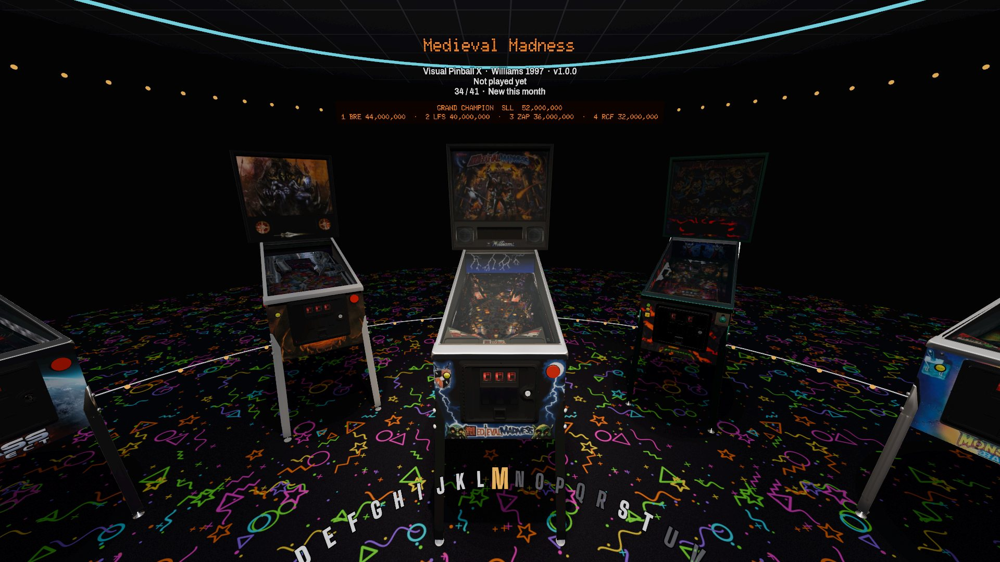
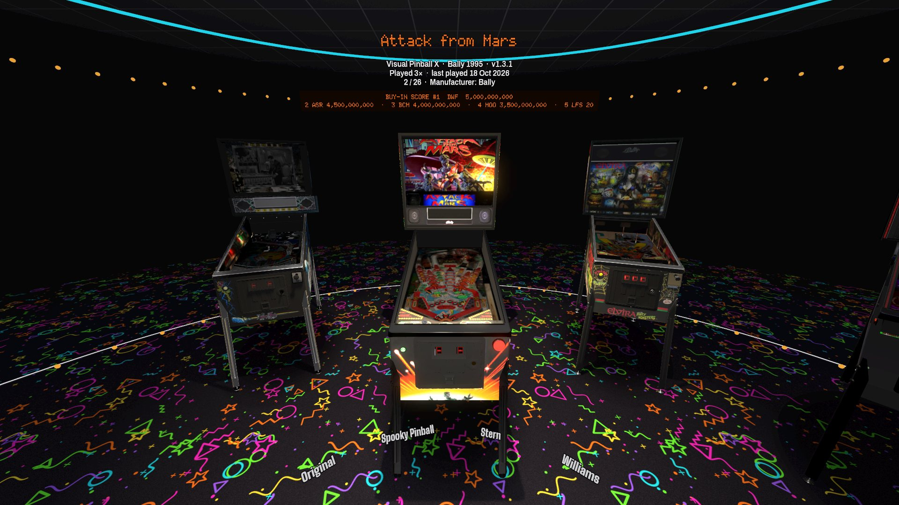
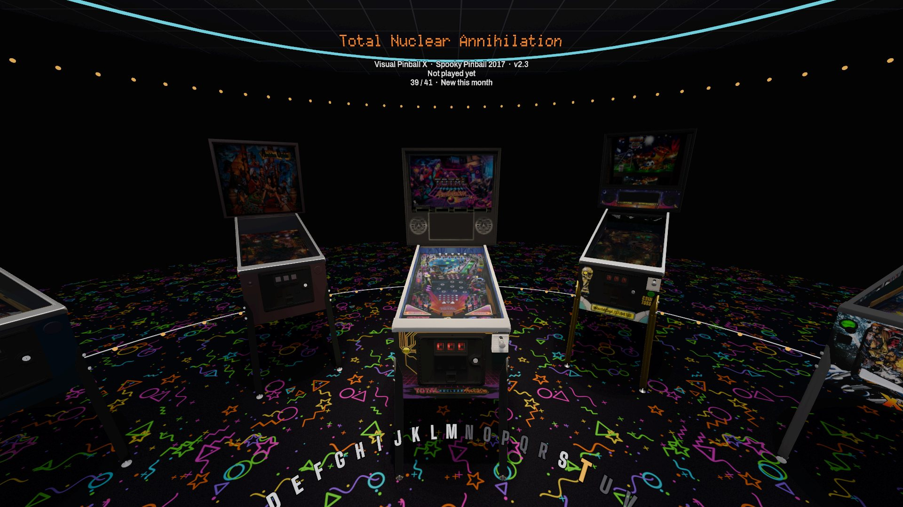
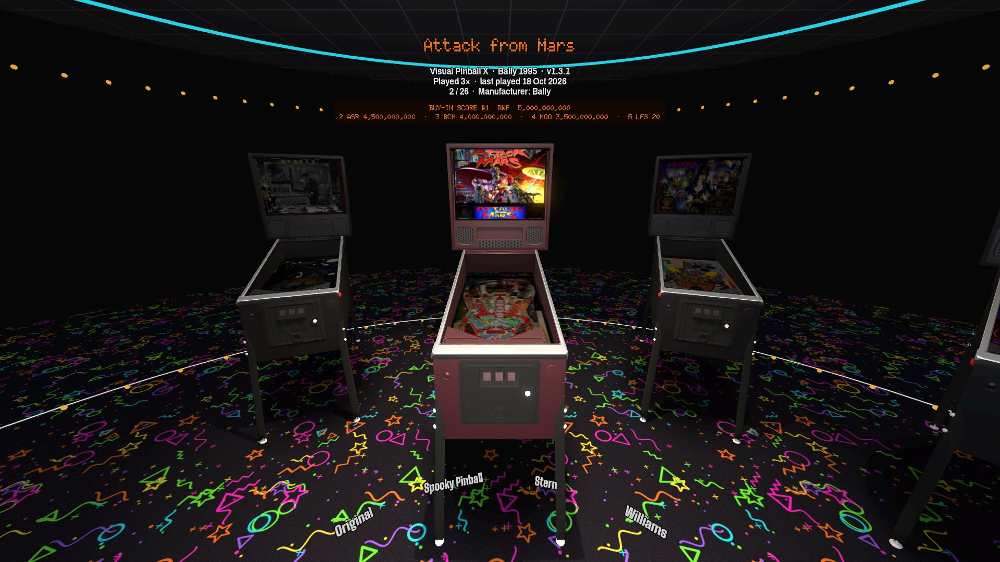

# VR Pinball Lobby: developer notes

The in-headset table picker for VR Table Manager, written in C# (Godot 4.7 .NET) on top of `VrTableManager.Core`, the same library the manager uses. So it lists exactly what the manager knows about (VPX, Future Pinball, Pinball FX and Pinball M), launches through the same engine code, and shares favourites and play history with it.

This file is for working on the lobby. How to use it is in [docs/vr-lobby.md](../docs/vr-lobby.md), and building and testing are in [DEVELOPING.md](../DEVELOPING.md).



| Attack from Mars | Total Nuclear Annihilation |
|---|---|
|  |  |

(Desktop-mode renders, 1920×1080. In the headset you stand about where the camera is.)

## Running it

A release ships the lobby exported (`VrLobby\VrLobby.exe`, its `.pck` and its own .NET), and the manager's **Launch VR Lobby** button starts that. `scripts\release.ps1` makes the export with the `Windows` preset in `export_presets.cfg`, which needs Godot's .NET export templates on the PC that builds the release. From source, see [DEVELOPING.md](../DEVELOPING.md): open the manager once first, so the lobby can find it to launch tables.

## Input

- **Cabinet buttons** are the player's own VPX controls, read from the settings VR play uses (VPX 10.8.1's `[Input]` mappings, or the older `[Player]` keys and joystick buttons; VPX's default keys where nothing is set). Joysticks Godot doesn't know as game controllers (cabinet boards) use the VPX joystick mapping: 10.8.1 names a joystick `SDLJoy_<SDL GUID>_<n>` and maps SDL's raw button numbers (d-pad directions as `0x100 + hat × 4 + direction`), which match Godot's for such joysticks; its bindings count only on the board with that GUID (`Input.GetJoyGuid`), unless no connected joystick has one.
- **Game controllers** Godot knows (`Input.IsJoyKnown`) use a fixed layout, since Godot renumbers their buttons to SDL's gamepad layout.
- **Where they count:** keys count only in VR, so the desktop window keeps its own keyboard controls. Joysticks work in both, and also while the lobby window isn't focused (`ignore_joypad_on_unfocused_application = false`), but not while a table plays with the lobby waiting behind it.
- **Log:** every controller is written to the lobby's log when it connects, and every button press too (`Joystick 0 button 3`).
- **State:** favourites and plays are in `%APPDATA%\VrTableManager\play-stats.json` (shared with the manager, picked up within 2 seconds), collections in `collections.json`, and the lobby's own filter and height in `lobby-state.json`. A play is counted by the manager's `--play` launcher once the table actually starts.

## The cabinets

Each table stands in **its own VR cabinet**, the 3D cabinet its author built into the `.vpx`: the real side art, backbox, speaker panel, lockdown bar, legs and coin door you'd see playing it in VPX VR.

- **How it's read:** the lobby picks out the cabinet parts in three ways:
  - by name (`PinCab_Cabinet`, `PinCab_Rails`, `Lockdownbar`, `VR_Legs…`, and camel-case ones like AC/DC's `TAFCabLeft`);
  - by place: anything shown that stands within the cabinet body's outline but not on the playfield, whatever it's called (AFM's key, AC/DC's box supports);
  - the boards around the playfield by shape, including VPX walls (AC/DC's backboard) and, on VPW tables that bake everything into one mesh (Metallica, Fish Tales), the back board's triangles out of that mesh.

  It leaves out the playfield's own toys and bolts, the VR room, lighting overlays, shadows, unlit copies and duplicates in the same place. A part with no picture of its own takes the one the table's script gives it (AC/DC's inner side panels), and a part round the playfield that the file hides but the script always shows counts as shown (Elvira's printed inner walls). It decodes their meshes and places them with VPX's own transform maths, at real size: about 0.72 m wide and 1.9 m to the top of the backbox. Parts that VPX draws "unlit" (backglasses, baked art) show as they are. The full rules, with the playfield height map and how the default cabinet takes a table's art, are in [CABINETS.md](CABINETS.md).
- **Standing on its legs:** VR cabinets are built in VPX's playfield space, where the playfield is level, so as read they lean back by the playfield's slope. The back legs reach the floor, but the front ones stop 14–21 cm above it. The lobby tips each cabinet forward until the lowest points at its front and back both touch the floor (2.8–6.7° on the tables here). The playfield picture takes the table's own slope (the middle of its SLOP–SLPX range, 5.2–7.2° here), since that is what VPX inclines a VR table by. Many cabinets have legs drawn for only 3–4°, and a playfield tipped with them looked sunk at the back. It turns about its own centre, so on those cabinets it sits a little steeper than the body.
- **When:** in the background the first time a cabinet comes into view. That takes 50–500 ms per table, plus texture decoding. Textures are capped at 1024 px and GPU-compressed (DXT). The 14 most recent cabinets stay in memory. No "extract" step is needed.
- **Cabinet cache:** what was read (merged meshes, materials, the compressed textures, playfield and backbox placement) is saved to `%APPDATA%\VrTableManager\vr-lobby\cabinets`, one `.cab` file per table (about 12 MB for Attack from Mars). Since the lobby restarts after every game, later visits load from there instead: Attack from Mars takes about 25 ms instead of 450 ms. A file is re-read when its table's size or date changes. Tables without a VR cabinet are remembered too. Delete the folder to start over.
- **Tables without their own cabinet** (desktop-only tables, Future Pinball, Pinball FX / M, and any table while its own is still loading) wear the **default cabinet**: Medieval Madness's VR cabinet, dumped once into `cabinet/default.cab` (750 KB: shape and materials only, its Williams artwork left out, since borrowing tables cover every printed surface anyway) and shipped with the lobby, so it's there from the first frame whether or not the table is installed. It keeps its shape and hardware (chrome, legs, coin door) and is skinned with that table's art:
  - **Cabinet art from the table's own VR cabinet:** most VR tables build their cabinet from the same community kit as the default one: a `PinCab_Cabinet` part with its sides and front on one square sheet, and a `PinCab_Backbox` part with the backbox's sides, front and speaker panel on one 1:2 sheet. A table shown on the generic cabinet (Setup's cabinet style, or My Tables per table) wears those sheets, and its backglass goes in the backbox's glass. A `.directb2s` picture's speaker grille is cropped off there, as that backbox has its own.
  - **The backbox is always the default cabinet's own**, with the table's kit art on it when it has some (its side colour otherwise), in one of two ways:
    - **Just the glass** (a landscape picture from a `.directb2s` with its grille cut off, from the table file, or yours): in the backbox's glass, over its speaker panel.
    - **A whole backbox front** (the catalog's picture, which is often a photo of the machine, or any picture nearly as tall as wide, such as an old machine's tall glass): the backbox is emptied, with no speakers or display, and the picture fills its front opening. A picture wider than the front brings the backbox down to fit (to 75% of its height at most) and is stretched the rest of the way (Fish Tales, The Getaway). EM backboxes have no speaker panel either.

    The plain box (the picture as its whole front, its height following the picture) is now only the drawn cabinet's, used when `cabinet/default.cab` is missing.
    A sheet is only borrowed when it's laid out like the default cabinet's (each side of the part takes its art from mostly the same place on the sheet): some tables only borrow the kit's names and lay their sheet out differently (Fish Tales'), which put the wrong art on the wrong faces.
  - **Inner walls and back panel:** the kit's `PinCab_Blades` sheet (the walls above the playfield) comes along with the other two. Without one, the table file's own wall strips go on the walls, laid along each wall's inner face (named like `bladel` / `blader`, `sideleft` / `sideright`, `LeftBlade…`, `sidearts`; long and narrow; one drawn standing up is turned). The back panel under the backbox wears the table file's own back-panel picture (named like `backpanel`, `backwall` or `backboard`, a wide strip; X-Men's lightning, JAWS's beach houses), laid on just its front face. Where a table has nothing for them, they're plain dark, like a black-bladed machine.
  - **Apron:** the template's apron (Medieval Madness's instruction cards) is hidden, so the playfield picture shows there.
  - Whatever printed art is left takes that table's side colour (a darkened average of its backglass).
- **Backglass picture in the lobby:** your picture, then the `.directb2s`, then **the table file's own backglass picture** (named like `BackglassImage`, `backglass`, `…BG` or `translite`, landscape; read once per table version into `vr-lobby\pictures`), then the catalog's. A table file's picture with a see-through or black window in the middle (X-Men's, made for a video behind it) is passed over for the catalog's.
- **Glass:** every cabinet (a table's own, the default one, the drawn one) has a faint glass sheet over the playfield, lying along the tops of the side rails on VR cabinets (8 cm longer than the playfield, at the rails' slope). It's drawn after the playfield and barely there, so the 3D playfield under it looks the same.

  To make it from another table: `godot --headless --path VrLobby -- "--dump-cabinet=C:\path\to\table.vpx"`. To preview it on every table, start the lobby with `-- --borrow-all`.
- **`cabinet/default.cab` missing:** a drawn cabinet, as a last resort only. It's read through Godot (`FileAccess`), so it works from inside the export's `.pck`; the export preset includes `cabinet/*.cab` (with the fonts and `icon.png`, also read as raw files) in its non-resource filter.
- **Playfield:** read straight out of the table's `.vpx`, at up to 2048 px, extracted once per table version into `%APPDATA%\VrTableManager\vr-lobby\pictures`. If a table has no usable flat playfield picture, its VPS picture is used instead. Metallica (Premium Monsters) is one: its playfield is baked into lighting atlases.
- **Playfield video:** when a table has a lobby video (`medias\lobby-video`: JPEG frames at 15 fps plus `video.json`), the selected cabinet's playfield plays it in a loop once the ring settles. Every other cabinet in view plays its video too (flat, at half size): in view meaning within 70° of where your head points, so ones you turn your head or the ring towards are already moving when they arrive; they stop past 85°. A video carries on from the same frame as its cabinet becomes, or stops being, the selected one, so it never drops back to the still picture in between. Frames are decoded a few ahead on a worker thread. VR Table Manager makes them (a table's MORE menu → **Get a playfield video for the VR lobby**, or **Get all VR lobby media**, which also fills whichever of the loading video, attract audio and wheel art are missing, from the same media pack or the catalog's wheel art and sound files; **GET LOBBY MEDIA** in My Tables does it for every table shown): from the playfield video in the table's community media pack, kept as `medias\(Playfield) <table>.mp4`, or, when there is none, from VPX's own `-CaptureAttract` recording of the attract mode in cabinet view (about half a minute, a small window, sound off). Tables built only for VR can record their VR room instead of the playfield; remove the video for those. **Use my own lobby video…** turns any video file you have into one (the first 12 seconds loop).
- **Your own pictures** ([how to](../docs/custom-artwork.md))**:** `playfield.*` and `backglass.*` (png, jpg, webp or bmp) in the table's `artwork` folder win over everything above, and your backglass also replaces the one a table's own VR cabinet brings. VR Table Manager's MORE menu → **My artwork** copies them in (plus `card.*`, its tile in My Tables). Tables without a folder of their own keep theirs in `%APPDATA%\VrTableManager\artwork\<table>-<hash>`.
- **Backglass:** the cabinet's own backglass when it has one. Otherwise the game's picture from the cached VPS catalog (`vpsdb.json`, no network), on the cabinet's backglass or on a panel on its backbox. With no picture at all, a lit title plate shows the table's name.
- **Wheel art:** the selected table's logo (a front end's wheel image) floats over its title, keeping its transparency, fitted into about 75 × 28 cm. From your own `wheel.*` in the table's `artwork` folder, else `medias\(Wheel) <table>.png`, which VR Table Manager's **Get wheel art for the VR lobby** (MORE) saves from the catalog's wheel art or the table's media pack. Tables without one show only the title. ([How to](../docs/custom-artwork.md#wheel-art-vr-lobby).)
- **Attract sound:** about 10 seconds plays quietly from the backbox when you settle on a VPX cabinet, from the first of:
  1. An `.ogg` / `.mp3` / `.wav` in the table's folder or its `music` folder (names with "attract", "intro" or "theme" first). VR Table Manager's **Get attract audio** (a table's MORE menu) saves one there as `music\attract.mp3` from the table's community media pack, when VPS lists one that has audio.
  2. Otherwise, the table's own ROM, recorded once: the first time you settle on a ROM table, a headless copy of the lobby (`-- --record-audio=<table path>`) runs the ROM in VPX's PinMAME for about 50 s. It drops coins, presses Start with balls in the trough (switch numbers read from the table script) and keeps the game-start music in `%APPDATA%\VrTableManager\vr-lobby\attract-audio\<rom>.wav`. It works on a scratch copy of the ROM with empty nvram, so your scores and settings are never touched. It's stopped when a table starts. ROMs that give nothing are remembered and not tried again. Turn it off with `LobbyRecordsRomAudio` in VR Table Manager's settings (default on), if it slows the lobby down.




## Look ("DMD & lamps", shared with the manager)

- **Room:** an arcade, in neutral black and charcoal (`#0A0A0B`, `#141416`, `#1E1E21`).
  - **Floor:** blacklight arcade carpet: neon squiggles, rings, stars, zigzags and confetti on black, glowing faintly. It's an original pattern, drawn at start-up from a fixed seed (`ArcadeRoom.cs`), and tiles every 1.5 m.
  - **Ceiling:** black drop-ceiling tiles on a grey metal grid at 3.6 m, with a magenta neon tube ring over the cabinets and a cyan one further out.
  - **Light:** the warm light comes from rows of small incandescent lamp bulbs (`#FFB23E`) and the displays. Chrome edges trace the floor.
- **Screenshots:** `godot --xr-mode off --path VrLobby -- --screenshot=<png> [--pitch=<degrees>]` saves one desktop frame and quits.
- **Display text:** the selected table's title, the big A–Z flash letter, and each cabinet's display use DMD plasma orange `#FF7A1F` in **Doto**, a dot-matrix font.
- **Lit things:** the current rail letter, the laser, the favourite star, the spotlight tint and the selected cabinet's backbox strip and coin lights are lamp amber.
- **Table types:** the other cabinets' lights use playfield-insert colours: blue `#3F95E8` VPX, red `#E5483B` Future Pinball, green `#63C46E` Pinball FX / M.
- **Fonts:** **Big Shoulders Display** for the rail and title plates, **Archivo** for the status and help text, **Doto** for display text. All are OFL-licensed, with copies and licences in `fonts/`.
- **Icon:** the manager's icon ("VR" in orange dot-matrix plasma dots on a black tile with a chrome edge, `icon.png`) is the window and app icon.

## How it works

```
VrTableManager.Core   models, table scanning, engines (VPX / Future Pinball / Pinball FX + UEVR),
                      headless play mode, lobby navigation + saved state, cabinet art lookups,
                      .vpx playfield extraction (VpxImages)
  ├─ VrTableManager   the Avalonia manager app (also: VrTableManager.exe --play …)
  ├─ VrLobby          this Godot C# project: room, cabinets, input, artwork
  └─ SmokeTest        plain-dotnet tests, including the lobby's navigation, art and play round trip
```

- **Cabinets are pooled:** only 11 cabinet nodes ever exist, however big the library. Table *i* always uses cabinet *i* mod 11, so turning the ring one step re-dresses a single cabinet.
- **Art loading:** pictures load only once the ring has nearly stopped, so flying through the alphabet doesn't decode art nobody sees. Decoding happens off the main thread. Only the 40 most recent pictures stay cached.
- **Cost per cabinet:** the geometry is built in code (`CabinetKit`) and shared by all cabinets, about ten draw calls each. There's one shadow-casting spotlight (on the selected cabinet), blob shadows under the others, 4× MSAA, and 16× anisotropic filtering for the playfields.
- **Chrome reflections:** the room's background is flat black, but reflections come from a small generated map (a soft ceiling light and a warm band of lamps), so chrome reads as chrome.
- **Launching:** the lobby checks that the engine is set up, then starts `VrTableManager.exe --play <table> --vr --return <lobby>`. That plays the table through the same engine as the manager's **Play in VR** button, waits for it to exit, and starts the lobby again with `--select=<table>`.
- **Loading screen:** while the table loads, the lobby stays in the headset. Only the table you picked is left in the room, with its title, a lamp chase and a seconds count. The manager reports on the launch in `play-status.json` (`--status`), next to the settings file.
- **Loading video:** when the table has a loading video (`medias\loading-video`: JPEG frames at 15 fps, `video.json` and `audio.mp3`), or there's one for every table (`%APPDATA%\VrTableManager\loading-video`), the cabinet steps aside and a screen of up to 2 × 1.4 m stands 2.7 m away, its top just under the lamps, playing it in a loop with its sound (restarted with each loop, so they stay together). Frames are decoded a few ahead on a worker thread, as for the playfield video. It stops, sound and all, when the table takes the headset or the launch fails. VR Table Manager makes them (MORE → **Get a loading video for the VR lobby** from Popper's `Loading` video in the media pack, or **Use my own loading video…**; Setup → **CHOOSE A VIDEO…** for every table): the first 30 s, at the video's own shape, 1280 px at most. Setting: **Play a loading video on the loading screen** (`LobbyLoadingVideos`, on by default). ([How to](../docs/custom-artwork.md#loading-video-vr-lobby).)
- **Handing over the headset:** the table's own OpenXR session takes focus from the lobby (the runtime gives focus to the newest VR app). The lobby notices and steps aside. VPX takes the focus before it has finished loading the table, so while the headset still shows the lobby (OpenXR's VISIBLE state) the loading screen should stay up, picture and all, for up to 20 seconds; its video's sound stops as soon as the table has the focus. Once the lobby isn't shown any more, it steps aside within half a second. Each change of the lobby's OpenXR state is written to its log (godot*.log) with the seconds since the launch, to see what a runtime does. It also quits if it is still waiting after 3 minutes, or when you hold Menu (Esc on desktop).
- **Quick return:** after stepping aside, the lobby **keeps running behind the table** with the whole room hidden, so there's next to nothing to draw. When the table closes (`play-status.json` says so), the room comes back on the table you played, its stats and high scores refreshed, and the runtime hands the headset straight back. There's no Godot start-up and no cabinets to reload. If the headset's focus hasn't come back after 8 seconds (a runtime that stopped the lobby's session), the lobby starts a fresh copy of itself on the same table and quits. If the runtime ends the lobby's session during play, it closes, and the manager starts it again when the table exits, as before. Setting: **Keep the VR lobby open behind the table** (`LobbyStaysOpen`, on by default). Turn it off if a big table runs short of graphics memory, since the lobby keeps its cabinets loaded.
- **When a table fails to start:** if it fails, or closes before it reaches the headset, the lobby goes back to the ring and shows why. The manager is passed the lobby's process id (`--lobby-pid`), so it doesn't start a second lobby when the first is still open.
- **Turning it off:** VR Table Manager's **Show a loading screen in the VR lobby while a table starts** setting (`LobbyWaitsForTable`, on by default). Turn it off for an OpenXR runtime that won't run two VR apps at once. Off, the lobby quits straight away, as it used to.

## Not verified yet (needs the headset)

- **Inside the headset:**
  - rendering, frame rate and comfort in the Quest 3 over Link / Air Link
  - the cabinet scale (does the selected one feel life-size at 0.9 m?)
  - the knee-height rail: is it easy to point at and read?
  - the title and stats floating above the backbox
- **Controls:** stick, trigger, Y (random), B, grips, the laser on cabinets and rail letters, and haptics.
- **Performance:** a full ring of real cabinets is roughly 0.3–1.5 million triangles (Fish Tales alone is 235k vertices) plus DXT textures; fine for a PC GPU, but check the frame rate over Link when turning the ring quickly. Also watch the moment a cabinet switches from the default cabinet to its own as it finishes loading.
- **The OpenXR handover:** the loading screen staying up while the table loads, the lobby stepping aside once the table takes focus, and the headset coming straight back to it when you exit. Also check the frame rate in the table with the lobby waiting behind it. Things to check: that the Quest Link runtime moves focus to VPX, and that Virtual Desktop's runtime does too, since it may allow only one VR app at a time.
- **Loading videos and wheel art:** the loading screen's video screen (its size, distance and height, and whether its sound is too loud next to the table starting), and the wheel over the title, have only been checked in the headless self-test, not in the headset. Neither has been tried with a real media pack's loading video or a catalog wheel download yet.
- **Attract sounds:** the recorded clips and the two media-pack files have not been listened to in the headset. Recorded so far: Medieval Madness, Black Knight 2000, Fish Tales, Avatar and X-Men (~25 s each); Attack from Mars gives only ~3 s (its game probably waits on another switch), but it now has a media-pack file.
- **Future Pinball (BAM-OpenVR + SteamVR), and Pinball FX / M through UEVR:** UEVR isn't installed on this PC.
- **Smoothness:** `godot --xr-mode off --path VrLobby -- --perf-trace[=steps]` steps through the tables by itself (8 by default, 3 s each) and prints every frame over 10 ms with what happened in it (art arriving, a cabinet ready, the ring snapping, the video or sound starting).
- **Height:** that Local Floor puts you at the right height, and the left-grip height control.

## Ideas for later

- Wheel art on every cabinet in the ring (a lit topper), not just over the selected one.
- A video backglass.
